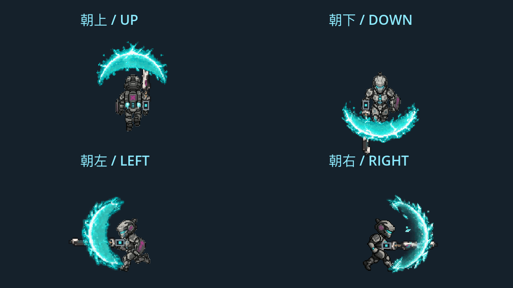

# 主角盾反动画

右键沿用现有 GuardComponent 状态机。GuardVisual 根据鼠标瞄准方向选择上、下、左、右四套独立的九帧透明图集；斜向瞄准在对应图集上补偿少量旋转。朝上在角色身后，侧面与朝下在身前。朝上使用与身体相同的世界 Z 并调整兄弟节点顺序，修复负 Z 可能让特效被地板遮住的问题。

- 起手 0.06 秒：第 1–4 帧。
- 完美格挡窗口：固定第 5 帧，来自用户选定原图的等比缩小版本。
- 普通格挡 0.18 秒：第 6–7 帧；成功盾反时先保持第 5 帧 0.08 秒。
- 后摇 0.22 秒：第 8–9 帧，结束隐藏。暂停停止计时，死亡立即隐藏。

判定时间、角度、反弹与回热规则保持原实现。装备完美窗口加成和后摇倍率通过状态实际进度同步。完整画布在角色旁偏移 22 游戏像素，72 游戏像素见方；实际展开盾面约高 60 游戏像素。

四方向素材都为 312×312、3×3 网格、每帧 104×104：

- 朝右：保留已确认的 `assets/art/vfx/player/parry_shield.png`；原件与制作记录仍位于 `art_sources/ai_drafts/player_protagonist/parry_shield_peak5_v1/`。
- 朝上、朝下、朝左：新增 `assets/art/vfx/player/parry_cardinal_v2/{up,down,left}.png`。内置 imagegen 以现有图集为参考生成；原图、完整提示词 `prompts.json` 与拆帧清单位于 `art_sources/ai_drafts/player_protagonist/parry_cardinal_v2/`。
- `tools/import_player_parry_directions.py` 只执行透明边界检查、裁帧、统一锚点、最近邻等比缩小和图集排版，不重绘源像素。各方向最大盾面约 60–62 游戏像素，原有整体画布和偏移保留。

专项验证：

```sh
godot --headless --path . --script res://tests/integration/player_parry_art_check.gd
godot --path . --windowed --resolution 960x540 --script res://tests/integration/player_parry_art_check.gd -- --capture
```

覆盖真实右键输入、九帧状态进度、第五帧峰值、四向与斜向位置和层级、正面反弹、背后拒绝、重置与重播、暂停、死亡以及真实引擎回调播放。渲染截图保存到 `docs/art/validation/player_parry_cardinal_v2/{up,down,left,right}.png`。测试背景与角色使用正常 Z 顺序，能覆盖朝上被地板遮挡的回归。

四方向专项 78/78、训练营 50/50、单元检查 62/62 通过；退出仍报告 ObjectDB/resource-in-use 警告，未将退出码为零解释为资源清理无问题。

## 已确认效果

2026-10-21：用户查看 Godot 引擎实机录制后确认采用当前四方向版本。以下动图同时播放上、下、左、右的实际 GuardComponent 时序，录制帧保留实际采集间隔；对应实现为 `5ae6705`、`5b1927e`。


