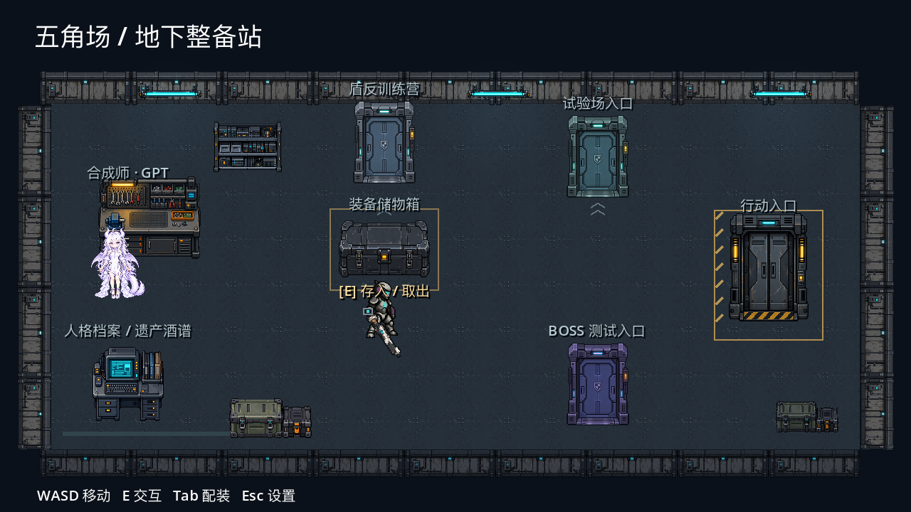
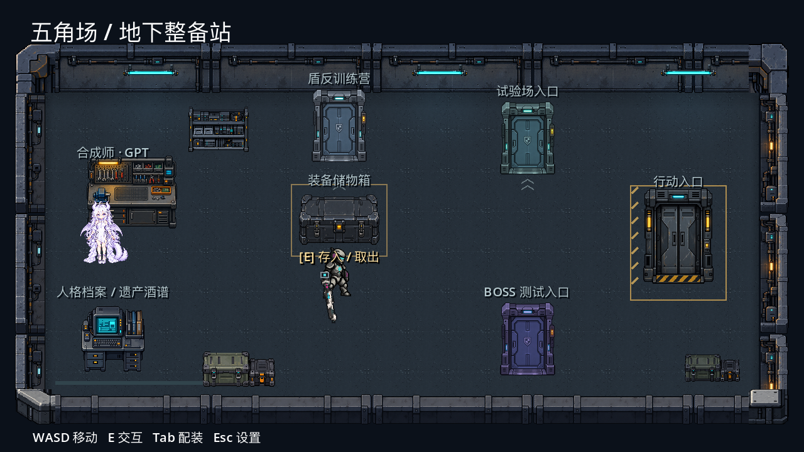
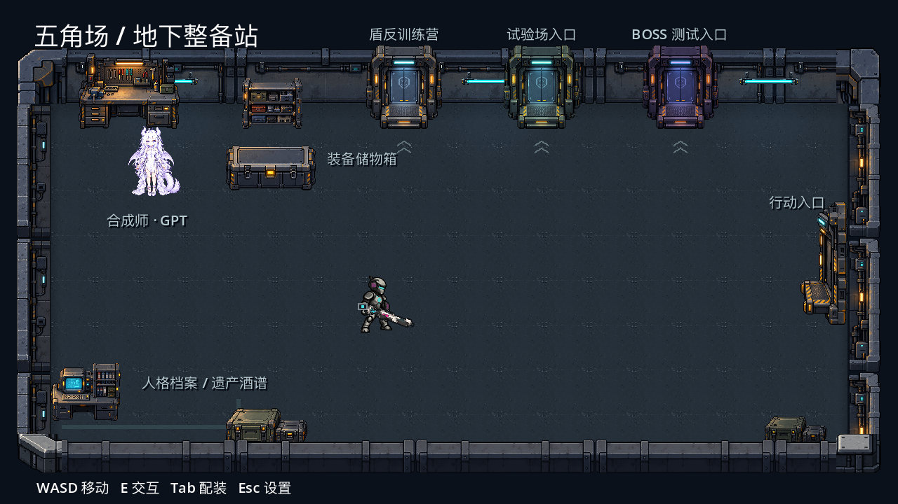

# 初始仓库模块美术接入

2026-10-21。用户确认地下维修安全屋方向，随后要求逐个生成组件，再在 Godot 中拼装地图。

## 组件与组装

内置 image_gen 独立生成十件组件：地板、墙段、储物箱、维修台、档案终端、出击电梯、训练门、零件架、货箱、壁灯。设备与墙段为透明 PNG；地板为不透明 PNG。三个次要入口复用训练门，使用既有名称、位置和不同色调区分。白发龙形合成师复用现有素材。

素材原图：`assets/art/environment/warehouse/`。完整提示词分别保存在 `art_sources/ai_drafts/warehouse_safehouse_v1/components_prompts.json` 和 `supplemental_prompts.json`。此前的整图 `concept_v1.png` 仅为概念参考，不作为游戏地图贴图。

`scripts/presentation/warehouse_art.gd` 负责独立纹理加载、透明边缘显示区域、32 游戏像素地砖铺设、四个朝向独立墙段与四个转角拼接、设备挂载、三盏无阴影青色灯及标签排版。原图保留生成分辨率，通过最近邻采样显示；没有声称原图是原生 32×32 手绘像素素材。

物理墙和储物箱原碰撞保留；维修台、零件架和两处货箱的脚印碰撞单独配置于 `warehouse.tscn/Fixtures`，不从 PNG 轮廓生成。中央出生点、七处交互节点的位置、存取、合成、档案、出击和训练业务逻辑保留。

## 验证

- Godot 4.7.2 编辑器导入：无脚本解析或资源加载错误。
- 仓库集成检查 58/58。
- 合成师交互检查 40/40。
- 盾反训练检查 50/50。
- 独立临时存档下，真实物理世界使用半径 8 像素的形状查询与网格连通检查，出生点到七个交互区域均可达（7/7）。该检查验证静态空间连通性，不代替人工操作手感测试。
- 非 headless 实机渲染已检查地砖、墙段、设备比例、角色、标签和灯光；截图为 `docs/art/validation/warehouse_safehouse_v1/warehouse.png`。
- 预览脚本使用独立存档，退出清理，不改写正式玩家进度。

退出仍有项目既有的 ObjectDB/resource-in-use 诊断；本次未做 Windows 导出验证。

## 墙体体积修订 v2

按用户反馈补齐有顶面、内侧立面和厚度的 2.5D 墙体：北墙完整立面、左右独立朝向墙、南侧低矮剖面墙与四个转角。不旋转后墙代替侧墙。转角通过 AtlasTexture 选取弯折接头区域，避免整段 L 形缩放造成透明缺口；原始 PNG 保留。前墙独立绝对 z_index=8，挡住靠墙角色的下缘。

八件源素材为 `assets/art/environment/warehouse/*_v2.png`。原四向墙与后侧转角在前一聊天生成，本次找回并接入；两件前侧转角本次使用内置 image_gen 补齐。完整生成提示词见 `walls_v2_prompts.json` 和 `foreground_corner_prompts.json`，均位于上述 AI 草稿目录。

本次重新执行编辑器导入及回归：仓库 58/58，合成师 40/40，盾反训练 50/50。非 headless 实机截图：`warehouse_walls_v2.png`；角色靠近前墙的独立存档预览：`warehouse_front_wall_v2.png`，均位于 `docs/art/validation/warehouse_safehouse_v1/`。保留已有退出资源释放诊断。

## 设备体积修订 v2

按用户追加要求，将储物箱、出击电梯、训练门、维修台、档案终端、零件架、货箱统一为同一固定俯视角的 2.5D 立体像素素材。门显示厚门框、凹入门扇、内侧壁与向前伸出的踏台；箱体和家具显示水平顶面、前立面、厚边和自身暗部。仍作为 Godot 2D Sprite2D 组件使用。

七件源图保存为 `assets/art/environment/warehouse/{chest,elevator,training_door,workbench,terminal,parts_rack,crates}_v2.png`，完整提示词见 `art_sources/ai_drafts/warehouse_safehouse_v1/props_v2_prompts.json`。内置 image_gen 使用已批准概念图作为统一风格与相机参考，逐件独立生成透明素材。显示时按可见区域等比缩放，保留原图顶面与立面的比例。原服务节点、存档与交互逻辑沿用。

## 靠墙布局与编辑器摆放

后续按用户要求将工作台与零件架靠北墙、训练门沿北墙、储物箱与档案终端靠左墙、出击电梯靠右墙、货箱靠南墙，原文关于七个服务位置不变的描述仅对应初版。同步调整实体碰撞，并让仓库交互测试根据 Chest 节点位置选择交互点。真实物理空间网格连通与交互目标选择验证 7/7。

用户选择在 Godot 编辑器中拖拽摆放后，将物件、AtlasTexture、标签和碰撞改为直接保存于 warehouse.tscn 的节点。SynthesisNPC 下的 Workbench 组成工作区，PartsRack、CratesLeft、CratesRight 各自拥有贴图与实体碰撞。WarehouseArt 使用 @tool 预览墙地，FrontParapet 为独立 @tool 图层；运行时仅增加灯光，不覆盖物件的位置。编辑器中拖动服务节点时，地面功能区域也随之预览更新。

编辑器导入无脚本/资源解析错误；布局保存、重新加载、贴图/实体碰撞/交互范围跟随检查 59/59；仓库、合成师、盾反训练重跑分别 58/58、40/40、50/50。最新运行截图为 warehouse_props_v2.png。操作方法见《仓库物品摆放指南.md》。

